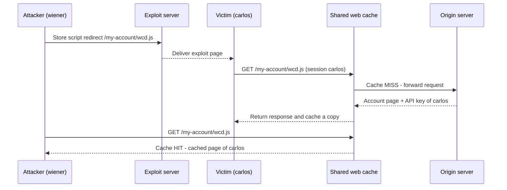

# Web Cache Deception — Exploiting Path Mapping Discrepancies

> **PortSwigger Web Security Academy — Lab Write-up**  
> **Chủ đề:** Web Cache Deception (WCD)  
> **Kỹ thuật:** Khai thác sự khác biệt trong cách ánh xạ URL path giữa **web cache** và **origin server**  
> **Mục tiêu:** Lấy API key của tài khoản `carlos` trong môi trường lab.

## 1. Giới thiệu lab


Trong bài lab này, ứng dụng có một trang `/my-account` hiển thị thông tin cá nhân, bao gồm **API key** của người dùng đang đăng nhập. Mình được cung cấp tài khoản thử nghiệm:

```text
Username: wiener
Password: peter
```

Mục tiêu là khiến nội dung riêng tư của tài khoản `carlos` bị lưu vào **web cache dùng chung**, rồi truy cập lại nội dung đó để lấy API key của `carlos`.

Điểm mấu chốt của lỗi là **origin server và web cache hiểu cùng một URL theo hai cách khác nhau**:

- **Origin server:** có thể xử lý `/my-account/wcd.js` như endpoint `/my-account` và trả về thông tin tài khoản của người đang đăng nhập.
- **Web cache:** thấy URL kết thúc bằng `.js`, cho rằng đây là tài nguyên tĩnh đủ điều kiện được cache.

Vì thế, một trang động chứa dữ liệu nhạy cảm có thể bị cache như thể nó là một tệp JavaScript công khai.

> **Lưu ý:** Toàn bộ thao tác bên dưới được thực hiện trong lab được cấp phép của PortSwigger. URL lab là URL của một phiên thực hành, không phải địa chỉ cố định có thể dùng lại lâu dài.

## 2. Đăng nhập và xác định endpoint chứa API key

Mở trình duyệt tích hợp trong Burp Suite và đăng nhập bằng `wiener:peter`.


Sau khi đăng nhập, trang tài khoản hiển thị API key của `wiener`. Endpoint quan trọng ở đây là:

```http
GET /my-account HTTP/1.1
Host: 0a760069046562e281332fcb00e500bb.web-security-academy.net
Cookie: session=<session-cua-wiener>
```

**Phân tích request (minh họa, không phải bản sao nguyên văn từ Burp):**

| Thành phần | Ý nghĩa |
|---|---|
| `GET` | Phương thức HTTP dùng để lấy nội dung trang. Các phản hồi GET thường được hệ thống cache xem xét lưu trữ. |
| `/my-account` | Endpoint hiển thị trang tài khoản. Nội dung phụ thuộc vào danh tính người gửi request. |
| `Host` | Tên miền của phiên lab PortSwigger mà mình đang kiểm thử. |
| `Cookie: session=...` | Cookie xác thực, giúp ứng dụng biết request thuộc về `wiener` hay `carlos`. |

Đây là **nội dung động, dành riêng cho từng tài khoản**. Trong một cấu hình an toàn, dữ liệu như API key không được lưu vào cache dùng chung để người khác có thể đọc lại.

## 3. Recon: kiểm tra cách origin server ánh xạ URL path

Trong Burp Suite:

1. Vào **Proxy → HTTP history**.
2. Tìm request `GET /my-account`.
3. Nhấp chuột phải và chọn **Send to Repeater**.
4. Trong **Repeater**, sửa path từ `/my-account` thành `/my-account/abc` rồi gửi request.


### Phân tích payload `/my-account/abc`

```diff
- GET /my-account HTTP/1.1
+ GET /my-account/abc HTTP/1.1
```

`abc` chỉ là một đoạn path tự chọn để kiểm tra xem server có bắt buộc URL phải khớp chính xác với `/my-account` hay không.

**Quan sát:** Phản hồi vẫn chứa API key của `wiener`.

**Ý nghĩa:** Origin server vẫn định tuyến request mới đến chức năng trang tài khoản; đoạn `/abc` không làm thay đổi tài nguyên được trả về trong phép thử này.

**Điều này KHÔNG chứng minh server đã cache API key.** API key vẫn là của `wiener` vì request vẫn được gửi trong phiên đăng nhập `wiener`, và ứng dụng vẫn phục vụ cùng chức năng tài khoản. Muốn xác định có web caching hay không, cần kiểm tra thêm header và hành vi khi gửi lại request.

## 4. Recon: kiểm tra quy tắc cache với đuôi `.js`

Tiếp theo, mình thay đoạn path tùy ý bằng một tên trông giống tệp JavaScript:

```http
GET /my-account/123.js HTTP/1.1
Host: 0a760069046562e281332fcb00e500bb.web-security-academy.net
Cookie: session=<session-cua-wiener>
```


### Tại sao lại dùng `123.js`?

- `123` là tên tùy ý, **không có ý nghĩa đặc biệt** đối với việc khai thác.
- `.js` là phần mở rộng thường dùng cho tài nguyên tĩnh, có thể khớp với quy tắc cache.
- Toàn bộ `/my-account/123.js` là đường dẫn được cache nhìn thấy; origin server vẫn có thể trả về nội dung của `/my-account`.
- Việc thêm `.js` **không có nghĩa là server thực sự lưu một tệp `123.js`**, và cũng không có nghĩa JavaScript sẽ được thực thi ở phía server.

### Kiểm tra lần 1: `X-Cache: miss`

Phản hồi có các header đáng chú ý:

```http
X-Cache: miss
Cache-Control: max-age=30
```

| Header | Giải thích |
|---|---|
| `X-Cache: miss` | Request lần này **không được phục vụ từ bản sao đã cache**. Chỉ riêng `miss` chưa đủ khẳng định phản hồi đã được lưu. |
| `Cache-Control: max-age=30` | Giá trị `30` biểu thị **thời gian freshness là 30 giây** theo chỉ thị `max-age`; không nhất thiết có nghĩa bản sao sẽ bị xóa vật lý ngay sau 30 giây. |

### Kiểm tra lần 2: `X-Cache: hit`

Gửi **lại cùng URL** trong khoảng thời gian cache còn hiệu lực. Header đổi thành:

```http
X-Cache: hit
```

Lúc này, phản hồi đã được phục vụ từ cache thay vì phải tạo lại hoàn toàn từ origin server.

Từ hai lần thử có thể suy ra hợp lý rằng:

1. Origin server vẫn trả về nội dung trang tài khoản cho path có hậu tố `.js`.
2. Web cache có quy tắc lưu phản hồi đối với path có dạng tệp tĩnh `.js`.
3. **Cách hiểu URL của hai thành phần không đồng nhất**, tạo điều kiện để dữ liệu động bị cache nhầm.

Đây là dấu hiệu đặc trưng của **Web Cache Deception thông qua path mapping discrepancy**.

## 5. Khai thác: khiến phản hồi của `carlos` được lưu vào cache

Sau khi xác định được quy tắc cache, mình chuyển sang **Exploit server** trong Burp và đặt đoạn HTML sau vào phần **Body**:

```html
<script>
  document.location = "https://0a760069046562e281332fcb00e500bb.web-security-academy.net/my-account/wcd.js";
</script>
```

Đây chính là payload được sử dụng trong quá trình thực hành.

### 5.1. Phân tích chi tiết đoạn JavaScript

| Mã lệnh | Vai trò |
|---|---|
| `<script> ... </script>` | Khai báo đoạn JavaScript sẽ chạy khi trang trên Exploit server được mở. |
| `document.location` | Thuộc tính dùng để chuyển trình duyệt đến URL được chỉ định. |
| `=` | Gán URL đích cho thuộc tính điều hướng. |
| Chuỗi URL trong dấu `"..."` | Địa chỉ mà trình duyệt nạn nhân sẽ truy cập. |

Đoạn mã này **không tự đánh cắp API key bằng JavaScript**, cũng **không phải XSS trên trang `/my-account`**. Nhiệm vụ của nó là đưa trình duyệt nạn nhân đến URL đã được xây dựng để đánh lừa cache.

### 5.2. Phân tích từng phần của URL khai thác

```text
https://0a760069046562e281332fcb00e500bb.web-security-academy.net/my-account/wcd.js
└─┬──┘ └─────────────────────────────┬──────────────────────────────┘ └─────┬─────┘ └──┬──┘
  │                                 │                                      │          │
HTTPS                         Tên miền lab                             Endpoint    Hậu tố
                                                                      tài khoản    .js
```

| Thành phần URL | Chức năng |
|---|---|
| `https://` | Giao thức HTTPS dùng để truy cập ứng dụng lab. |
| `0a760069046562e281332fcb00e500bb.web-security-academy.net` | Host của **phiên lab cụ thể**. Khi khởi tạo lab mới, phần định danh có thể thay đổi. |
| `/my-account` | Endpoint động chứa thông tin tài khoản của người dùng đang đăng nhập. |
| `/wcd.js` | Đoạn path tùy chọn kết thúc bằng `.js`, nhằm làm web cache xử lý URL như một tài nguyên tĩnh. |

**Vì sao dùng `wcd.js` thay vì giữ nguyên `123.js`?**

`123.js` đã được mình truy cập trước đó khi đang đăng nhập với tài khoản `wiener`. Nếu tiếp tục dùng chính URL này, cache có thể đang chứa **trang của `wiener`**. Khi `carlos` truy cập, họ có thể nhận ngay bản cache cũ, nên cache không được điền bằng phản hồi của `carlos`.

Đổi sang `wcd.js` nhằm tạo **cache key mới chưa bị mình sử dụng**. Nhờ vậy, lần truy cập đầu tiên của `carlos` có cơ hội tạo bản cache chứa thông tin của chính `carlos`.

> `wcd` chỉ là nhãn viết tắt của *Web Cache Deception*. Có thể thay bằng một tên tùy ý khác, miễn là URL phù hợp với quy tắc cache và chưa chứa phản hồi cũ của mình.

### 5.3. Gửi payload đến nạn nhân

Trong Exploit server:

1. Dán đoạn `<script>...</script>` vào phần **Body**.
2. Nhấn **Store** để lưu nội dung exploit.
3. Nhấn **Deliver exploit to victim** để mô phỏng việc nạn nhân `carlos` mở trang exploit.


Khi trình duyệt nạn nhân chạy script, nó sẽ truy cập URL `/my-account/wcd.js`. Với phiên đăng nhập hợp lệ của `carlos`, origin server trả về trang tài khoản của `carlos`. Web cache nhìn URL kết thúc bằng `.js` và lưu phản hồi theo quy tắc cache đã phát hiện.

**Luồng khai thác:**



**Lưu ý:** Sơ đồ mô tả cơ chế được quan sát trong lab, không khẳng định mọi hệ thống cache ngoài thực tế đều bỏ qua cookie hoặc có cùng chính sách cache.

## 6. Đọc lại URL đã đầu độc cache và lấy API key

Sau khi gửi exploit, mình mở chính URL đã gửi cho nạn nhân:

```text
https://0a760069046562e281332fcb00e500bb.web-security-academy.net/my-account/wcd.js
```


Nếu cuộc tấn công thành công, phản hồi có thông tin tài khoản và **API key của `carlos`**, dù request truy xuất được gửi từ phía mình.

### Vì sao mình đọc được dữ liệu của người khác?

Vấn đề nằm ở việc **web cache tái sử dụng phản hồi nhạy cảm giữa các phiên**:

- `carlos` tạo phản hồi động chứa thông tin cá nhân của họ.
- Cache lưu phản hồi này theo URL `/my-account/wcd.js`.
- Khi mình gửi request đến **đúng URL đó**, cache có thể trả về bản sao đã lưu, thay vì tạo phản hồi tương ứng với phiên của mình.

Nói cách khác, dữ liệu bị rò rỉ qua **cached HTTP response**, không phải vì đã biết mật khẩu của `carlos` và cũng không phải vì JavaScript có quyền đọc trực tiếp cookie của nạn nhân.

### Nếu vẫn thấy API key của `wiener` thì sao?

Trong quá trình thực hành, mình gặp tình huống truy cập URL nhưng kết quả vẫn hiển thị tài khoản cũ. Có thể kiểm tra theo thứ tự:

1. Trong **Exploit server**, nhấn **Store** để chắc chắn nội dung script đã được lưu, sau đó nhấn **Deliver exploit to victim**.
2. Kiểm tra URL trong script và URL mình truy cập lại **khớp hoàn toàn**.
3. Dùng **một path `.js` mới, chưa bị thử bằng phiên `wiener`**, để tránh cache key đã chứa phản hồi cũ.
4. Theo dõi `X-Cache` trong Repeater; lưu ý bản cache ở lab có thời gian freshness khoảng **30 giây**, nên cần thao tác khi phản hồi của nạn nhân còn có thể được phục vụ từ cache.

Trong lần thực hành này, lưu lại exploit bằng **Store**, gửi lại với **Deliver exploit to victim**, rồi truy cập lại URL là cách mình xử lý được tình huống trên.

## 7. Nộp API key và hoàn thành lab

Sau khi đọc được API key của `carlos`, mình sao chép giá trị đó và gửi qua chức năng **Submit solution** của lab.


Lab xác nhận hoàn thành thành công.


> Không cần công khai API key thực tế hoặc session cookie trong repository. Ảnh chụp màn hình, nếu chứa thông tin nhạy cảm còn hiệu lực, nên được che trước khi đăng công khai.

## 8. Root cause và bài học rút ra

### 8.1. Nguyên nhân gốc rễ

Bài lab thể hiện ba điều kiện kết hợp thành lỗ hổng:

1. **Path mapping discrepancy:** origin server chấp nhận một URL có phần đuôi bổ sung nhưng vẫn trả về nội dung nhạy cảm của endpoint gốc.
2. **Overly broad cache rule:** web cache xem phần mở rộng `.js` là điều kiện phù hợp để cache, dù phản hồi thực chất là một trang tài khoản động.
3. **Cross-user cache exposure:** bản phản hồi có chứa dữ liệu theo session có thể được phục vụ lại cho người truy cập cùng cache key, không được tách biệt an toàn theo danh tính người dùng.

Điểm quan trọng nhất là **cache key không nhất thiết phản ánh đầy đủ các yếu tố xác định nội dung riêng tư của một phản hồi**, đặc biệt là trạng thái đăng nhập.

### 8.2. Hướng phòng chống

- Đánh dấu các phản hồi chứa API key hoặc thông tin tài khoản bằng chính sách phù hợp, chẳng hạn **`Cache-Control: no-store`**, và bảo đảm các lớp cache thực sự tuân thủ.
- Không cache nội dung nhạy cảm chỉ vì **URL có phần mở rộng giống tệp tĩnh**.
- Tách rõ tuyến đường nội dung tĩnh và động; tránh để endpoint riêng tư xử lý tùy tiện các path bổ sung.
- Đảm bảo cache và origin server áp dụng **cách chuẩn hóa và ánh xạ đường dẫn nhất quán**.
- Kiểm thử với nhiều tài khoản khác nhau để phát hiện trường hợp cùng một URL trả về dữ liệu của người khác.
- Không coi việc thêm `Vary: Cookie` đơn lẻ là biện pháp bảo vệ đầy đủ; cần một chính sách cache rõ ràng cho các nội dung được xác thực.

### 8.3. So sánh Web Cache Deception và Web Cache Poisoning

| Web Cache Deception | Web Cache Poisoning |
|---|---|
| Làm cho **phản hồi riêng tư** bị lưu nhầm trong cache và có thể bị người khác đọc. | Làm cho cache lưu **phản hồi bị thao túng**, sau đó phát tán nội dung đó đến người truy cập khác. |
| Mục tiêu thường là **đọc dữ liệu nhạy cảm**. | Mục tiêu thường là **ảnh hưởng nội dung phản hồi được phục vụ cho người khác**. |
| Trong lab này, thông tin bị lộ là **API key của `carlos`**. | Không phải kỹ thuật chính được sử dụng trong bài lab này. |

## 9. Kết luận

Qua bài lab, mình hiểu rõ hơn rằng **việc hai thành phần trong hệ thống xử lý cùng một URL theo các quy tắc khác nhau có thể dẫn đến rò rỉ dữ liệu nghiêm trọng**.

Payload cốt lõi rất đơn giản:

```text
/my-account/wcd.js
```

Nhưng hiệu quả của nó không đến từ tên `wcd.js`; hiệu quả xuất phát từ việc **origin server trả về trang tài khoản động**, trong khi **web cache lại lưu trang này như một tài nguyên tĩnh**. Kết quả là phản hồi của `carlos` có thể bị trả về cho người khác khi truy cập cùng URL.

---

### Tài liệu tham khảo

- [PortSwigger — Lab: Exploiting path mapping for web cache deception](https://portswigger.net/web-security/web-cache-deception/lab-wcd-exploiting-path-mapping)
- [PortSwigger — Web cache deception: cơ chế, phát hiện và khai thác](https://portswigger.net/web-security/web-cache-deception)

*Write-up phục vụ mục đích học tập và thực hành bảo mật trong môi trường được cấp phép.*
